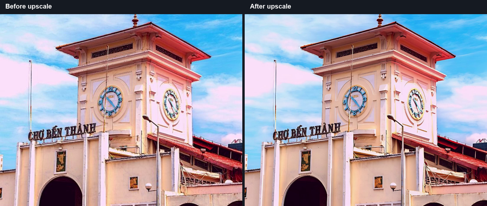
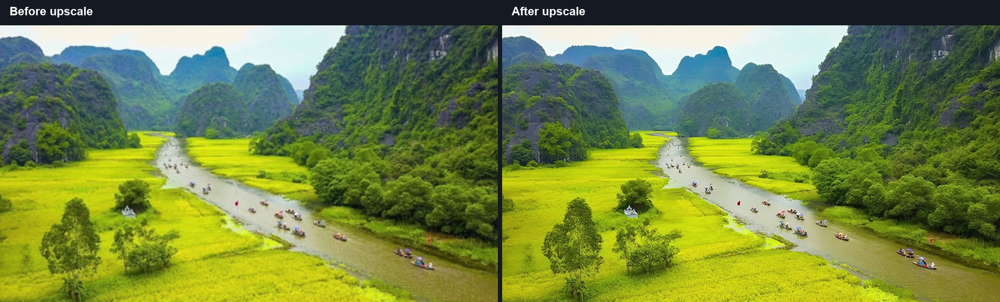
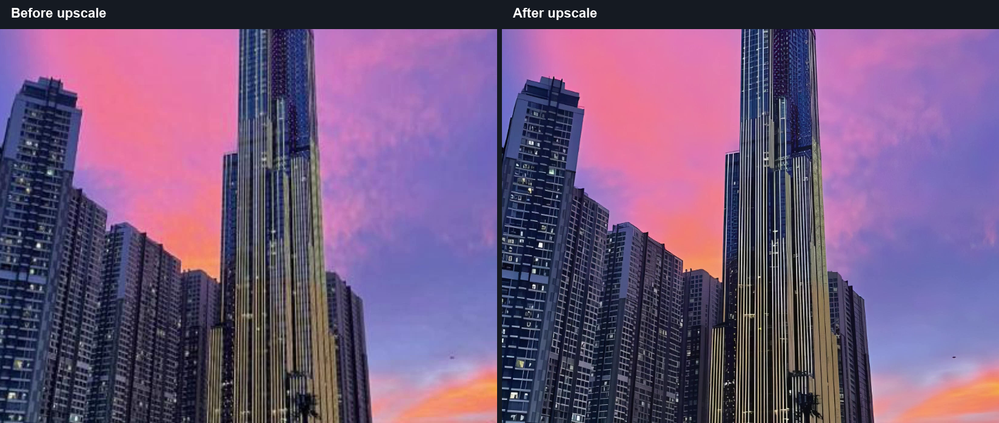
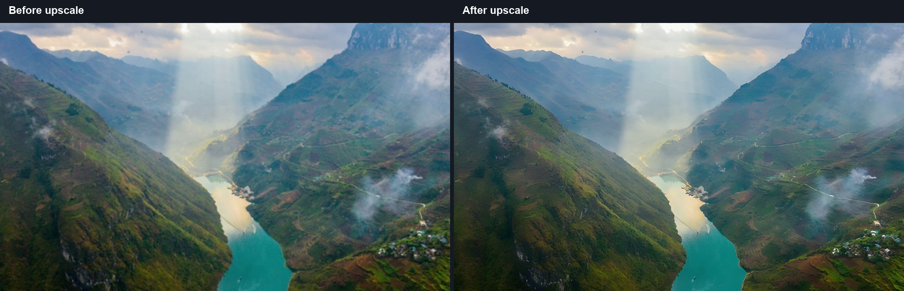
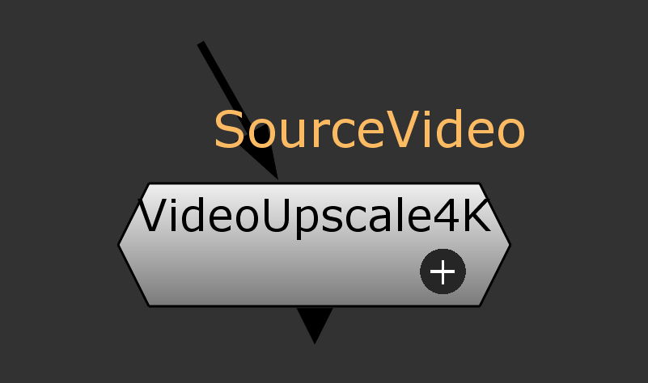
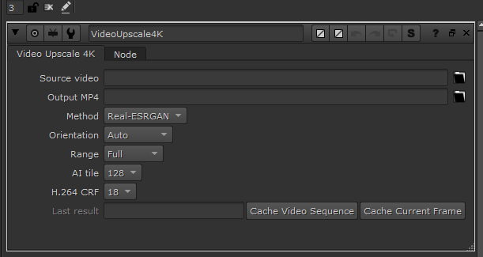

# VideoUpscale4k

VideoUpscale4k is a Windows plug-in for Foundry Nuke that upscales footage or a 2D node graph to a 4K MP4 cache. Cache a single frame for a quick check or process a video sequence, then use the result directly in the Viewer or downstream nodes.

[Video demo](#video-demo) · [Requirements](#requirements) · [Installation](#installation) · [Quick start](#quick-start) · [Output and color](#output-and-color) · [Uninstall](#uninstall)

## Video demo

https://github.com/user-attachments/assets/0969d5b2-d883-4044-86cd-1e18e3cf53cb

### Before and after upscaling

Four comparisons from the demo video. The source is on the left and the upscaled result is on the right.









## Requirements

- **Windows 64-bit** with Foundry Nuke. Tested on Nuke and Nuke 17
- **Real-ESRGAN** requires an NVIDIA GPU and a driver that supports the bundled CUDA 12.8 runtime.
- **Lanczos** runs on the CPU.

The complete Windows package bundles Python, PyTorch, FFmpeg, FFprobe, and the Real-ESRGAN model. Processing runs locally and works offline.

## Installation

1. Extract the complete package and double-click [`Install.bat`](Install.bat).
2. Restart Nuke.
3. In the Node Graph, press **Tab** and search for **Video Upscale 4K**. The node is also available under **Image → Video Upscale 4K**.

The installer copies the plug-in to `%USERPROFILE%\.nuke\VideoUpscale4k` and adds a relative entry to the user's `.nuke\init.py`.

```python
import nuke

nuke.pluginAddPath('./VideoUpscale4k')
```

## Quick start

1. Save your Nuke script and create a **Video Upscale 4K** node.
2. Connect a **Read** node or another 2D image node to **SourceVideo**. Connect the plug-in's output to a Viewer or downstream node.
3. In **Properties**, choose **Real-ESRGAN** or **Lanczos**, then set **Orientation** and **Range**.
4. Click one of the cache buttons.

| Button | Result |
| --- | --- |
| **Cache Current Frame** | Writes a one-frame MP4 from the current timeline frame. The output holds that image until you replace the cache. |
| **Cache Video Sequence** | Writes a video using **Range**. Choose **Full**, **First 5s**, or **First 10s**. |

A new node passes the input through until a cache is ready. Caching starts when you click a cache button, and the output switches to the new MP4 when processing finishes.

With a graph input connected, the **Source video** and **Output MP4** fields are hidden. To use the node independently, leave the input disconnected and choose a file in **Source video**. You can enter a custom **Output MP4** path or leave it blank to use the default cache folder.

### Plug-in screenshots

**Video Upscale 4K in the Node Graph**



**Video Upscale 4K Properties panel**



## Output and color

- **Cache location** — By default, MP4s are stored in `output upscale 4k` next to the saved `.nk` file. The script stores the cache path, so keep the MP4 available there when reopening the comp.
- **Resolution** — **Auto** preserves the input's display aspect ratio, sets the long edge to 3840 pixels, and rounds the short edge to an even number. **Landscape** and **Portrait** fit the image into 3840 × 2160 or 2160 × 3840 and add padding as needed.
- **Timing and audio** — A sequence cached from a directly connected video **Read** uses the original media and retains its audio when available. Other graph inputs render over the comp's frame range at its FPS and produce video without audio. Variable-frame-rate media is converted to a constant frame rate based on the source's average FPS.
- **Color** — Graph caches use the same color space to write intermediate frames and read the resulting MP4 back into Nuke. Real-ESRGAN also corrects broad color shifts against the input. The cache is H.264 SDR 8-bit, so compression and the SDR color range can introduce differences.

After changing an upstream node, click **Cache Video Sequence** again to update the video cache.

## Uninstall

1. Close Nuke.
2. Remove the **Nuke Video Upscale 4K** registration block from `%USERPROFILE%\.nuke\init.py`.
3. Remove `%USERPROFILE%\.nuke\VideoUpscale4k`.

## Third-party components

- The AI model comes from [xinntao/Real-ESRGAN](https://github.com/xinntao/Real-ESRGAN).
- The package includes a Gyan Essentials build of FFmpeg with libx264. See the [bundled FFmpeg license](bin/FFmpeg-LICENSE.txt).
- See the [bundled Python license](runtime/LICENSE.txt) for the Python runtime.

The bundled binaries are intended for internal distribution. Review the applicable third-party notices and source distribution requirements before publishing a package that includes them.
